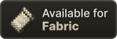

# KillenCraft Badges

Cozy and compact badges for KillenCraft Minecraft mods, in the [Devin's Badges](https://github.com/intergrav/devins-badges) style.

<p>
  
  
  
</p>
<p>
  
</p>

## Available badges

| Badge                   | Style   | Path                        |
| ----------------------- | ------- | --------------------------- |
| Supported: Forge        | Cozy    | `cozy/supported/forge`      |
|                         | Compact | `compact/supported/forge`   |
| Supported: Fabric       | Cozy    | `cozy/supported/fabric`     |
|                         | Compact | `compact/supported/fabric`  |
| Requires Stope          | Cozy    | `cozy/requires/stope`       |
|                         | Compact | `compact/requires/stope`    |
| Report issues on GitHub | Cozy    | `cozy/support/issues`       |
|                         | Compact | `compact/support/issues`    |
| KillenCraft             | Cozy    | `cozy/brand/killencraft`    |
|                         | Compact | `compact/brand/killencraft` |

Every badge comes in two formats:

- `<name>.png` for CurseForge and anywhere SVG isn't reliably displayed
- `<name>_vector.svg` for GitHub, Modrinth, and other sites that display SVG

PNGs are exported at 2x. Set the `height` attribute when you use them, or they will display at double size.

## Using a badge

Link to the files through jsDelivr, pinned to the major version:

```
https://cdn.jsdelivr.net/gh/KillenCraft/badges@1/<style>/<category>/<name>.png
```

### Requires Stope

If your mod depends on [Stope](https://www.curseforge.com/minecraft/mc-mods/stope), you're welcome to use this badge on your own page.

**HTML (CurseForge):**

```html
<a href="https://www.curseforge.com/minecraft/mc-mods/stope"
  ></a>
```

**Markdown (GitHub, Modrinth):**

```markdown
[](https://www.curseforge.com/minecraft/mc-mods/stope)
```

Stope is required on both Forge and Fabric. If your mod also needs Fabric API, say "Fabric only" next to that badge so players don't mix up the two.

### Full KillenCraft strip

This is the standard header for KillenCraft mod pages. Row 1 tells players what they need; row 2 tells them where to go.

```html
<p>
  
  
  <a href="https://www.curseforge.com/minecraft/mc-mods/stope"
    ></a>
</p>
<p>
  <a href="https://discord.gg/HpGvhxZ2at"
    ></a>
</p>
```

On Stope's own page, leave out the Requires Stope badge.

## Versioning

Releases are tagged with semantic versions (`v1.0.0`, `v1.1.0`, ...). jsDelivr resolves `@1` to the newest `1.x.x` tag.

- **Minor releases** add badges. Existing files are never renamed, moved, or deleted, so pinned links keep working.
- **Major releases** change the look of the whole set. Pages pinned to the old major version are unaffected until you update them.

Don't link to `@main`. It follows every commit and is cached only briefly.

## Credits

Badge design is based on [Devin's Badges](https://github.com/intergrav/devins-badges) by intergrav, released under CC0 1.0. The Forge and Fabric badges are copied unchanged from that project. The Forge and Fabric logos belong to their respective projects.

## License

The badges in this repository are released under [CC0 1.0](LICENSE). No attribution is required.

Third-party art used inside the badges, if any, is listed in [THIRD_PARTY_NOTICES](THIRD_PARTY_NOTICES) under its own license.
